# prismarine-semantic

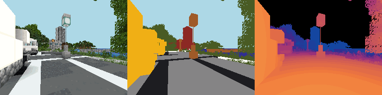

*RGB, semantic class, metric depth. Lake Merritt, Oakland. © OpenStreetMap contributors.*

Render aligned RGB, semantic and depth images from inside a Minecraft world. A headless
[mineflayer](https://github.com/PrismarineJS/mineflayer) bot joins a server, and
[prismarine-viewer](https://github.com/PrismarineJS/prismarine-viewer) draws what it has loaded from any pose you give it.
Every pixel comes back with its RGB colour, a semantic class id and a depth in metres, all taken from the same camera.

Pair it with [arnis-semantic](https://github.com/flyingtankboi/arnis-semantic) and any real city becomes a source of
labelled images: arnis-semantic builds the Minecraft world from OpenStreetMap, plus a twin world in which every block is
replaced by its class. Any ordinary Minecraft world also works for RGB and depth, only the labels need the twin.

## Places

All images use a pinhole camera and a render distance of 17 chunks (256 m).

RGB, semantic class and depth of one camera in each image. Depth: near is warm, far is cool.

**City streets**, at eye height.

| | |
|---|---|
| 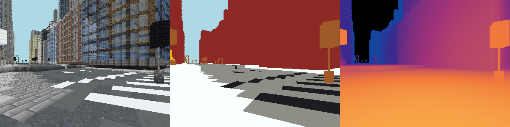<br><sub>Midtown Manhattan, New York. © OpenStreetMap contributors.</sub> | 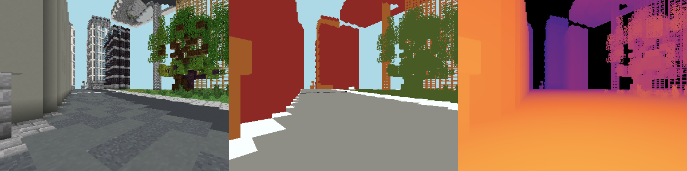<br><sub>Shinjuku, Tokyo. © OpenStreetMap contributors.</sub> |
| 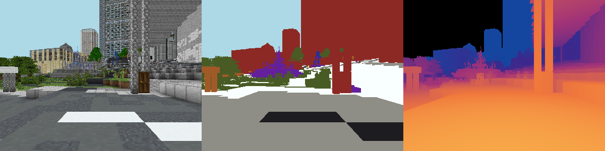<br><sub>Central, Hong Kong. © OpenStreetMap contributors.</sub> | 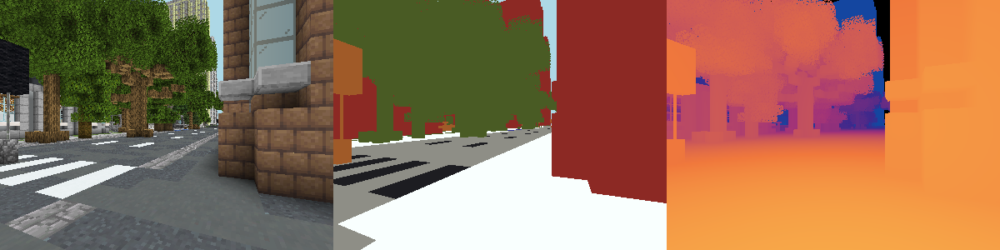<br><sub>The Loop, Chicago. © OpenStreetMap contributors.</sub> |
| 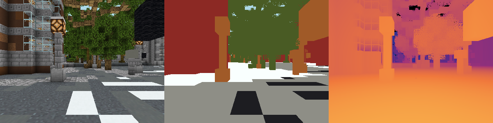<br><sub>Opéra, Paris. © OpenStreetMap contributors.</sub> | 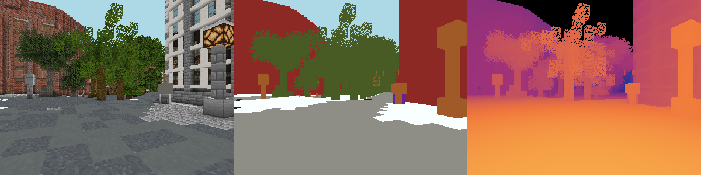<br><sub>Eixample, Barcelona. © OpenStreetMap contributors.</sub> |
| 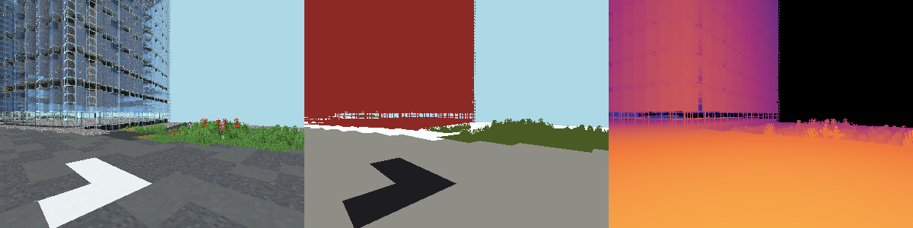<br><sub>Gangnam, Seoul. © OpenStreetMap contributors.</sub> |  |

**Landmarks from above**, camera 100 m up and pitched down.

| | |
|---|---|
| 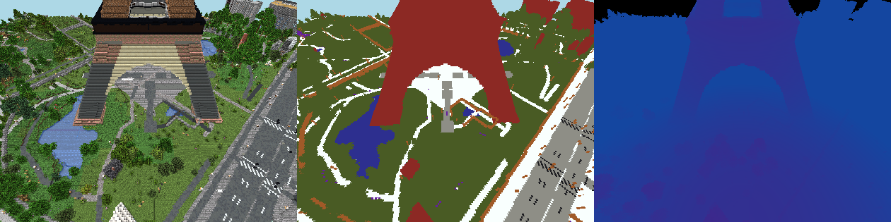<br><sub>Eiffel Tower and Champ de Mars, Paris. © OpenStreetMap contributors.</sub> | 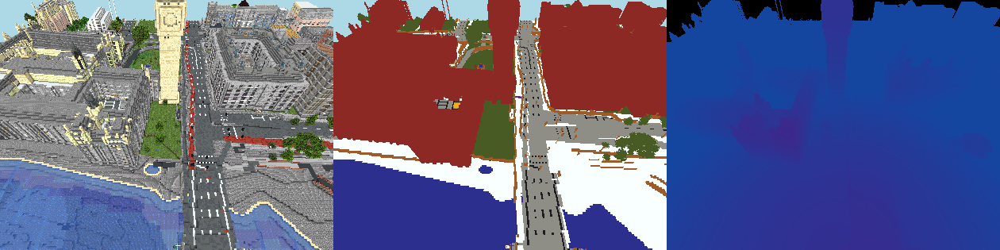<br><sub>Westminster and the Thames, London. © OpenStreetMap contributors.</sub> |
| 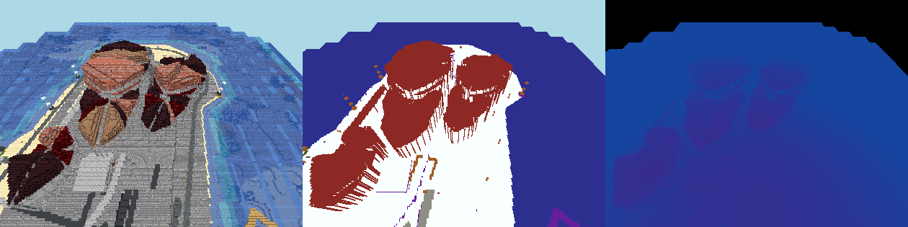<br><sub>Opera House and harbour, Sydney. © OpenStreetMap contributors.</sub> | 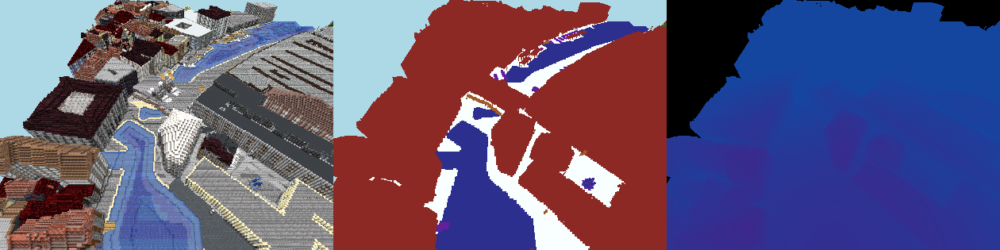<br><sub>Grand Canal, Venice. © OpenStreetMap contributors.</sub> |
| 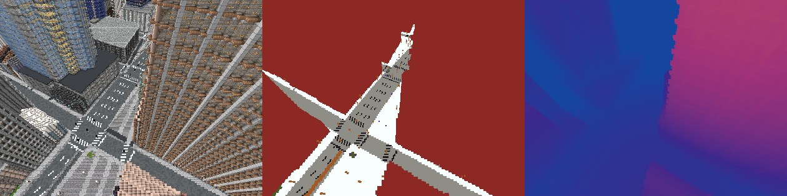<br><sub>Times Square, New York. © OpenStreetMap contributors.</sub> |  |

## What you get

`render(pose)` returns three arrays of one image, row-major, top row first:

| output | type | content |
|---|---|---|
| `rgb` | `Uint8Array`, width x height x 3 | colour as the viewer draws it, 8 bits per channel |
| `semantic` | `Uint8Array`, width x height | class id per pixel, from the twin world's `semantic_legend.json` |
| `depth` | `Float32Array`, width x height | metres from the camera to the surface, along the pixel's ray |

- Depth is the straight-line distance along each pixel's ray (range), not the distance along the optical axis, and it is
  the same for pinhole and fisheye. Where nothing is within 256 m, such as sky, it is `Infinity`. Fisheye pixels outside
  the image circle are 0.
- Depth is packed into 24 bits on the GPU over 256 m, so the step is about 15 micrometres before it becomes a float32.
- Semantic ids follow the legend of the world. For worlds from arnis-semantic:

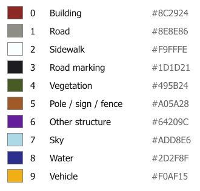

Class ids come from the twin world, so a different twin can use a different table. A block that the legend does not list
becomes 255, and air above the world becomes the sky class.

## Quick start

You need Node 18 or newer and a Minecraft Java server, 1.21.1 tested, with `online-mode=false`, serving the normal world.
The bot (default name `capture`) runs `/tp`, so make it an operator. The twin world is only read from disk. The server's
`view-distance` limits how far the bot sees: set it to `viewDistance + 1` or more.

```
npm install
npm rebuild canvas gl      # recent npm versions skip the native install scripts
npm run example -- --world path/to/MyWorld_semantic --port 25565 --pos 120,-58.4,86 --out view.png
```

`--pos` is the eye position in block coordinates. Add `--frames 24` for a GIF that turns once around, `--projection
fisheye --fov 170` for a fisheye, or `--yaw` and `--pitch` in degrees to aim. Run the script without arguments for the
full list.

## API

```js
const { connect } = require('prismarine-semantic')

const cap = await connect({
  port: 25565, version: '1.21.1', semanticWorldDir: 'path/to/MyWorld_semantic',
  projection: 'pinhole', fov: 90, width: 320, height: 240
})
const pose = { x: 120, y: -58.4, z: 86, yaw: 0, pitch: 0 } // radians, mineflayer convention
await cap.teleport(pose)
const { rgb, semantic, depth } = await cap.render(pose)
cap.close()
```

`pose` is the eye position in blocks. Yaw 0 faces north (-z) and grows towards west; positive pitch looks up.

| option | default | meaning |
|---|---|---|
| `projection` | `'pinhole'` | `'pinhole'` is a normal perspective camera, drawn in one pass at the requested size. `'fisheye'` draws five cube faces and stitches them. |
| `fov` | 90 / 170 | degrees. Pinhole: horizontal, below 180. Fisheye: across the image circle, up to 270. |
| `width`, `height` | 320, 240 | output size in pixels |
| `model` | `'equidistant'` | fisheye lens: `equidistant`, `equisolid` or `stereographic` |
| `span` | `'circle'` | what the fisheye `fov` spans: the image `circle`, the `diagonal` or the `width`. Pixels outside the circle are empty. |
| `faceSize` | 256 | cube face edge for fisheye; larger is sharper and slower |
| `viewDistance` | 5 | chunks meshed around the eye. Terrain is present out to `(viewDistance - 1) * 16` m in every direction, beyond that the image shows sky. Depth and the camera end at 256 m, so 17 is the useful maximum. |
| `workers` | 1 | mesher threads |
| `timeoutMs` | 60000 | limit for chunk loading and meshing per pose |
| `settleMs` | 1500 | quiet time after which the edge of the world is assumed, when part of the chunk disc never arrives |
| `host`, `port`, `username`, `version` | `localhost`, 25565, `capture`, none | server |

One process drives one bot. For more throughput run several processes, each with its own `username` (op each one) and its
own set of poses.

`cap.renderFaces(pose)` gives the raw cube faces instead: `rgb`, `semantic` and `depth`, each an array of five buffers in
the order front, left, right, up, down. Depth there is the distance along the face axis. `createLens` and `stitch` turn
the faces into a fisheye image, which is what `projection: 'fisheye'` does.

## Pinhole, fisheye and cube faces

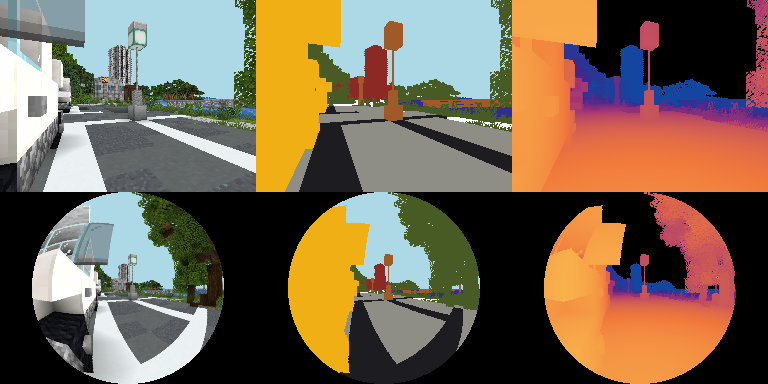

*Top: pinhole, 90 degrees. Bottom: equidistant fisheye, 170 degrees. Columns: RGB, semantic, depth. Lake Merritt, Oakland. © OpenStreetMap contributors.*

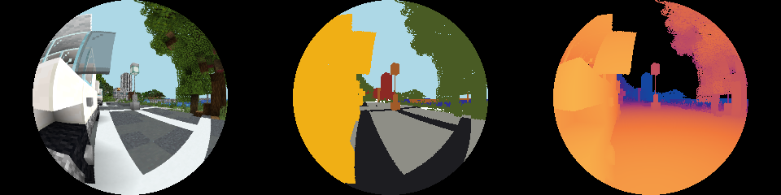

*Equidistant fisheye, 170 degrees, 320 x 240: RGB, semantic, depth. Lake Merritt, Oakland. © OpenStreetMap contributors.*

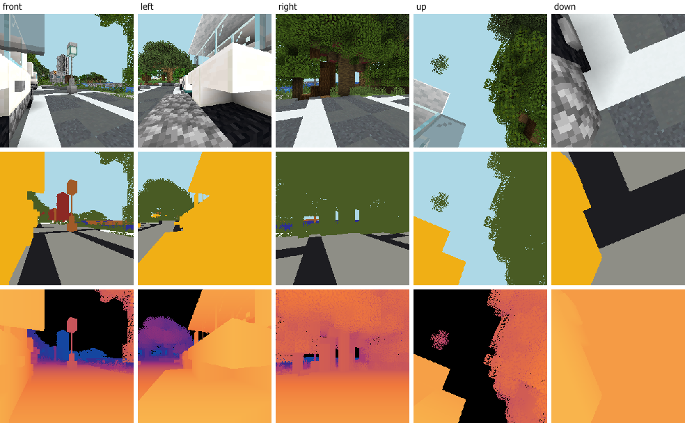

*The five 90 degree cube faces the fisheye is stitched from. Rows: RGB, semantic, depth. Lake Merritt, Oakland. © OpenStreetMap contributors.*

### Fisheye gallery

RGB, semantic class and depth through different lenses and fields of view. The black corners lie outside the image
circle: with `span: 'circle'` the `fov` spans the circle, and pixels outside it stay empty.

| | |
|---|---|
| 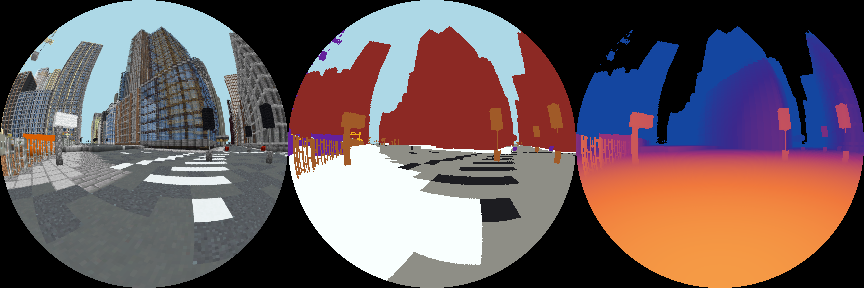<br><sub>Midtown Manhattan, New York. Equidistant, 180 degrees, street level. © OpenStreetMap contributors.</sub> | 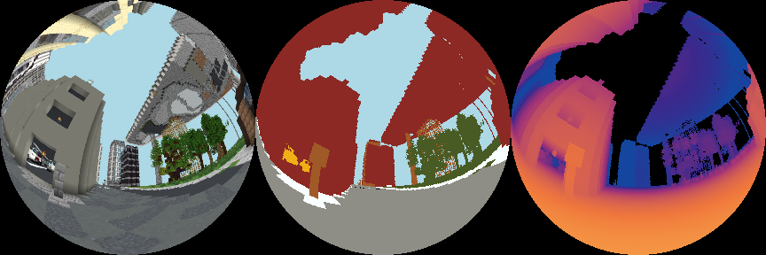<br><sub>Shinjuku, Tokyo. Equisolid, 200 degrees, looking up 40 degrees. © OpenStreetMap contributors.</sub> |
| 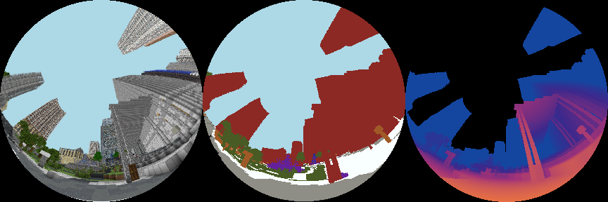<br><sub>Central, Hong Kong. Stereographic, 170 degrees, looking up 65 degrees. © OpenStreetMap contributors.</sub> | 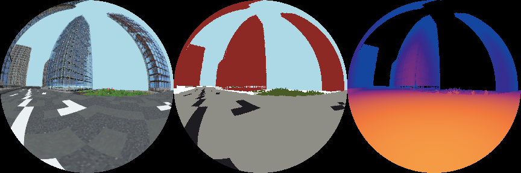<br><sub>Gangnam, Seoul. Equidistant, 200 degrees, street level. © OpenStreetMap contributors.</sub> |
| 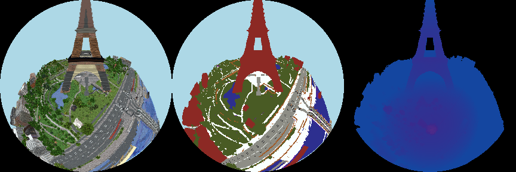<br><sub>Eiffel Tower and Champ de Mars, Paris. Equidistant, 180 degrees, from above looking down 50 degrees. © OpenStreetMap contributors.</sub> | 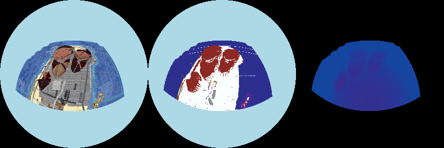<br><sub>Opera House and harbour, Sydney. Equisolid, 190 degrees, from above looking down 60 degrees. © OpenStreetMap contributors.</sub> |

## How the semantic labels work

Labels are not rendered from the server. The twin world (`<name>_semantic`) has the same layout as the normal one,
but each block stands for a class, for example `red_concrete` for buildings and `light_gray_concrete` for roads, and
`semantic_legend.json` in that folder maps blocks to class ids. This tool reads the twin's `.mca` region files directly.
When a section of the normal world is meshed, every quad gets the class of the block it belongs to, and a shader draws
that id instead of the texture. Both worlds need the same coordinates, which arnis-semantic guarantees by writing them in
one pass. See [arnis-semantic](https://github.com/flyingtankboi/arnis-semantic) for how the classes are chosen.

## Patches

prismarine-viewer 1.33.0 is patched on install with [patch-package](https://github.com/ds300/patch-package). The three
patches in `patches/` are independent and small enough to send upstream:

1. `negative-y`: use the world's minimum Y instead of 0, so worlds that go below Y 0 (1.18+) are meshed completely.
2. `chunk-wait`: `waitForChunksToRender` counts every dirty request instead of treating a section as done after the first
   answer, and takes an optional timeout.
3. `geometry-hook`: `WorldRenderer.geometryHook(geometry, data)` runs on each new section mesh, `Viewer` accepts
   `{ numWorkers }`, and empty sections are skipped.

mineflayer is used unmodified. The texture atlas ships in the prismarine-viewer npm package and is not part of this
repository. To build one from the Mojang assets in `minecraft-assets`, run `npm run prerender -- 1.21.1`.

## Limitations

- Developed and tested on Windows. Linux and macOS should work but are untested.
- Rendering uses [headless-gl](https://github.com/stackgl/headless-gl): it needs a working OpenGL or software
  implementation (on a Linux server, `xvfb-run` or Mesa), and `canvas` and `gl` need their native builds.
- No entities: players, mobs, items and vehicle entities are not drawn. Only blocks are rendered, with no lighting,
  weather or sky; sky is whatever is not covered by loaded blocks.
- Only the blocks the bot has loaded are drawn, which is a disc of `viewDistance` chunks around the eye, because that is
  what the server sends. Call `teleport` before `render` when you move far.
- A fisheye lens cannot reach behind the camera, which limits its `fov` to 270 degrees.
- mineflayer logs some `PartialReadError` messages when joining 1.21.1 servers. They did not affect the capture.

## Tests

```
npm test
```

Fast unit tests, no server needed.

## Credits

Built on [mineflayer](https://github.com/PrismarineJS/mineflayer) and
[prismarine-viewer](https://github.com/PrismarineJS/prismarine-viewer) by PrismarineJS, with
[headless-gl](https://github.com/stackgl/headless-gl) for rendering. The example worlds were built with
[arnis-semantic](https://github.com/flyingtankboi/arnis-semantic) from OpenStreetMap data, © OpenStreetMap contributors
([ODbL](https://www.openstreetmap.org/copyright)).

## License

MIT. The files in `patches/` modify prismarine-viewer, which is also MIT; its notice is in `patches/NOTICE`.
