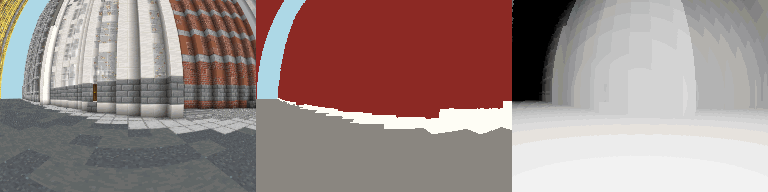

# prismarine-semantic



*Left to right: RGB, semantic classes, depth. A full turn at one spot, rendered as a fisheye.*

Renders aligned RGB, semantic and depth views from inside a Minecraft world. A headless
[mineflayer](https://github.com/PrismarineJS/mineflayer) bot joins a server and
[prismarine-viewer](https://github.com/PrismarineJS/prismarine-viewer) draws what it has loaded. The result is five
90 degree cube faces per pose, which you can use as they are or stitch into a fisheye image.

Semantic worlds come from [arnis-semantic](https://github.com/flyingtankboi/arnis-semantic), a fork of
[Arnis](https://github.com/louis-e/arnis) that writes a second world next to the normal one, with every block replaced by
its class. Any vanilla world works for RGB and depth; the semantic output needs the twin world.

## What you get

For each of the five faces (front, left, right, up, down) at a pose:

- `rgb`: `Uint8Array`, size x size x 3
- `semantic`: `Uint8Array`, size x size, one class id per pixel (255 = unlabelled)
- `depth`: `Float32Array`, size x size, metres along the face's forward axis, `Infinity` for sky

Depth is packed into 24 bits on the GPU over 256 m, so the step is about 15 micrometres. `stitch` turns the faces into one
fisheye image (equidistant, equisolid or stereographic) with depth converted to distance along each pixel's ray.

## Quick start

You need Node 18 or newer and a Minecraft Java server (1.21.1 was tested) with `online-mode=false` and the bot op'd,
because the bot teleports with `/tp`. The server must run the regular world; the semantic world is only read from disk.

```
npm install
npm rebuild canvas gl      # recent npm versions skip the native install scripts
npm run example -- --world path/to/MyWorld_semantic --port 25565 --pos 120,-58.4,86 --out view.png
npm run example -- --world path/to/MyWorld_semantic --port 25565 --pos 120,-58.4,86 --frames 24 --out view.gif
```

`--pos` is the eye position in block coordinates. The bot is named `capture`. In code:

```js
const { connect } = require('prismarine-semantic')

const cap = await connect({
  port: 25565, version: '1.21.1', semanticWorldDir: 'path/to/MyWorld_semantic',
  projection: 'pinhole', fov: 90, width: 320, height: 240 // or projection: 'fisheye', fov: 170, model: 'equidistant'
})
const pose = { x: 120, y: -58.4, z: 86, yaw: 0, pitch: 0 } // radians, mineflayer convention
await cap.teleport(pose)
const { rgb, semantic, depth } = await cap.render(pose)
cap.close()
```

`projection: 'pinhole'` renders one perspective view at the requested horizontal `fov` (below 180 degrees). `'fisheye'`
renders five cube faces and stitches them; `fov` spans the image circle and can go up to 270 degrees. Both give the same
three outputs, with depth as distance along each pixel's ray.

`connect` also takes `viewDistance` (chunks meshed around the eye, default 5), `faceSize` (cube face size for fisheye, default
256) and `workers`. The example takes `--projection`, `--fov` and `--lens` too.

The texture atlas that prismarine-viewer draws with ships in its npm package and is not part of this repository. To
build one yourself from the Mojang assets in `minecraft-assets`, run `npm run prerender -- 1.21.1`. The output lands in
`node_modules` and is ignored by git.

## How the semantic labels work

Labels are not rendered from the server. The semantic twin world (`<name>_semantic`) has the same layout as the regular
one, but each block is a stand-in for a class, for example `red_concrete` for buildings and `light_gray_concrete` for
roads. `semantic_legend.json` in that folder lists the block to class id mapping. The renderer reads the twin's `.mca`
region files directly, and when a section of the regular world is meshed, every quad is given the class of the block it
belongs to. A shader then draws the class id instead of the texture. Blocks missing from the legend become 255, and air
above the world becomes the sky class.

Both worlds need the same coordinates, which arnis-semantic guarantees by writing them in one pass.

## Patches

prismarine-viewer 1.33.0 is patched on install with [patch-package](https://github.com/ds300/patch-package). The three
patches in `patches/` are independent and small enough to send upstream:

1. `negative-y`: use the world's minimum Y instead of 0, so worlds that go below Y 0 (1.18+) are meshed completely.
2. `chunk-wait`: `waitForChunksToRender` counts every dirty request instead of treating a section as done after the first
   answer, and takes an optional timeout.
3. `geometry-hook`: `WorldRenderer.geometryHook(geometry, data)` runs on each new section mesh, `Viewer` accepts
   `{ numWorkers }`, and empty sections are skipped.

mineflayer is used unmodified.

## Limitations

- Developed and tested on Windows. Linux and macOS should work but are untested.
- Rendering uses [headless-gl](https://github.com/stackgl/headless-gl): it needs a working OpenGL or software
  implementation (on a Linux server, `xvfb-run` or Mesa), and `canvas` and `gl` need their native builds.
- Only the blocks the bot has loaded are drawn. Entities, weather, lighting and sky are not rendered.
- The bot's chunk window is `(2 * viewDistance - 1)` chunks wide, so terrain is guaranteed out to
  `(viewDistance - 1) * 16` metres only.
- Block classes are per block, so anything the semantic world does not label ends up as 255.
- The fisheye lens must not reach behind the camera, which limits `fov` to 270 degrees.
- mineflayer logs some `PartialReadError` messages when joining 1.21.1 servers. They did not affect the capture.

## Tests

```
npm test
```

The tests are fast unit tests and need no server.

## License

MIT. The files in `patches/` modify prismarine-viewer, which is also MIT; its notice is in `patches/NOTICE`. Worlds made
from OpenStreetMap data carry the [ODbL](https://www.openstreetmap.org/copyright) attribution.
